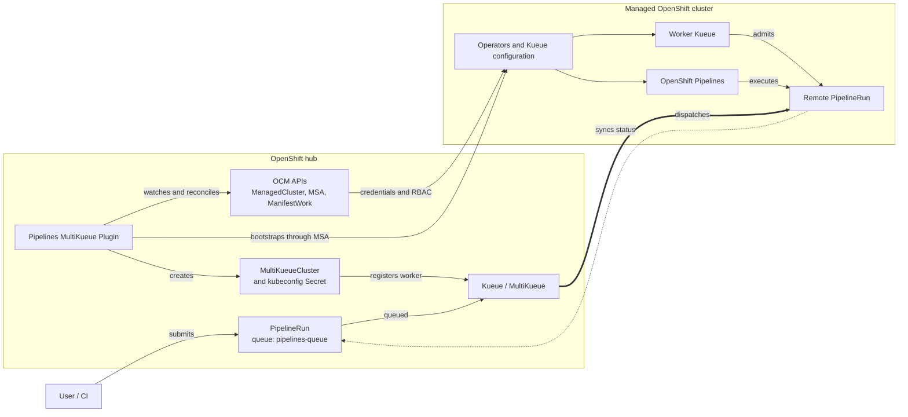

# Pipelines MultiKueue Plugin

Pipelines MultiKueue Plugin configures an OpenShift hub and its managed clusters so [Kueue](https://kueue.sigs.k8s.io/) can dispatch [Tekton PipelineRuns](https://tekton.dev/docs/pipelines/pipelineruns/) across clusters.

The controller is intended to run on an Open Cluster Management hub. It watches non-local `ManagedCluster` resources and connects each eligible cluster to Kueue MultiKueue.

## Architecture

The plugin bootstraps the MultiKueue connection; Kueue then dispatches queued `PipelineRuns` and returns their status to the hub.



## What the controller does

On the hub, the controller:

- creates OLM subscriptions for Red Hat OpenShift Pipelines, the Red Hat build of Kueue Operator, and cert-manager Operator for Red Hat OpenShift, and [upgrades](#operator-upgrades) the ones it created;
- configures `tekton.dev/v1` `PipelineRun` as a Kueue external framework;
- creates the default resource flavor, cluster queue, local queue, admission check, and MultiKueue configuration; and
- creates a `MultiKueueCluster` for every eligible managed cluster.

For each managed cluster, it:

- creates a `ManagedServiceAccount` and the RBAC needed to access the cluster;
- installs, upgrades, and configures the required operators through the managed-cluster credentials; and
- maintains the kubeconfig Secret used by MultiKueue.

The local cluster is skipped when its `ManagedCluster` has the label `local-cluster=true`.

## Prerequisites

- An OpenShift cluster acting as an Open Cluster Management hub
- One or more registered `ManagedCluster` resources
- The Open Cluster Management `ManifestWork` API
- The Managed Service Account add-on and API
- OLM access to the `redhat-operators` catalog on the hub and managed clusters
- Cluster-admin access for deployment
- Go 1.26+ for local development
- Docker or Podman and an image registry for building and deploying a custom image

> [!IMPORTANT]
> The controller creates cluster-scoped Kueue resources and installs operators on the hub and managed clusters. Review the defaults below before deploying it.

## Build and test

```sh
git clone https://github.com/openshift-pipelines/pipelines-multikueue-plugin.git
cd pipelines-multikueue-plugin

go test ./...
mkdir -p bin
go build -o bin/controller ./cmd
```

Build and push the controller image:

```sh
export IMG=quay.io/<account>/pipelines-multikueue-controller:dev
make docker-build IMG="$IMG"
make docker-push IMG="$IMG"
```

## Deploy

Point `KUBECONFIG` at the hub cluster, generate a release manifest for your image, and apply it:

```sh
export IMG=quay.io/<account>/pipelines-multikueue-controller:dev

kubectl create namespace tekton-kueue \
  --dry-run=client -o yaml | kubectl apply -f -

make release IMG="$IMG" VERSION=dev
kubectl apply --server-side -f release/release-dev.yaml
kubectl rollout status \
  deployment/pipelines-multikueue-plugin-controller \
  -n tekton-kueue \
  --timeout=5m
```

The `release` target updates the image in `config/kustomization.yaml` and writes the rendered manifest to `release/release-<version>.yaml`.

Verify the generated MultiKueue resources:

```sh
kubectl get multikueueclusters.kueue.x-k8s.io
kubectl get multikueueconfigs.kueue.x-k8s.io pipelines-multikueue-config
kubectl get clusterqueues.kueue.x-k8s.io pipelines-multicluster-kueue
kubectl get admissionchecks.kueue.x-k8s.io pipelines-multikueue-ac
kubectl get localqueues.kueue.x-k8s.io pipelines-queue -n default
```

## Submit a PipelineRun

The default `LocalQueue` is created in the `default` namespace. Add its queue label to a `PipelineRun` in that namespace:

```yaml
apiVersion: tekton.dev/v1
kind: PipelineRun
metadata:
  generateName: multikueue-
  namespace: default
  labels:
    kueue.x-k8s.io/queue-name: pipelines-queue
spec:
  # Add pipelineRef or pipelineSpec here.
```

Create a `LocalQueue` pointing to `pipelines-multicluster-kueue` before submitting queued `PipelineRuns` in another namespace.

## Operator upgrades

Each reconcile compares the channel of every operator Subscription against the configured channel (see [Defaults](#defaults)). When the two differ, the controller moves the Subscription onto the configured channel and OLM performs the upgrade. It then waits for `status.installedCSV` to catch up with `status.currentCSV` before continuing.

**Only the controller's own operators are touched.** A Subscription it created carries the label `app.kubernetes.io/managed-by: pipelines-multikueue-plugin`. If an operator was already on the cluster when the controller arrived, or was installed by someone else, its channel is left alone and its lifecycle stays with whoever owns it. The controller stamps the same label on the namespaces and `OperatorGroups` it creates. This holds unconditionally — nothing below overrides it.

A Kubernetes `ownerReference` cannot express this, because the controller runs on the hub while most of these resources live on a managed cluster, and an `ownerReference` only resolves inside one cluster.

**The configured channel is applied, with one exception: the controller will not roll an operator back through a release series.** That is the only move it refuses, and it only applies when both channels carry a version under the same prefix:

| Installed channel | Configured channel | Result | Why |
| --- | --- | --- | --- |
| `stable-v1.5` | `stable-v1.4` | **left alone** | Same prefix, lower version — a rollback. |
| `stable-v1.4` | `stable-v1` | **left alone** | Also a rollback: `1` is behind `1.4`. |
| `stable-v1` | `stable-v1.4` | moved | Same prefix, higher version. `stable-v1.9` to `stable-v1.10` counts as forward too. |
| `stable-v1.4` | `fast-v1.5` | moved | Different prefixes: the two versions number unrelated series, so neither is behind the other. |
| `stable-v1.5` | `fast-v1.4` | moved | Same reason — a lower number across a rename is not a rollback. |
| `latest` | `pipelines-1.23` | moved | The installed channel carries no version, so it cannot be ahead of anything. |
| `pipelines-1.23` | `latest` | moved | The configured channel carries no version, so it cannot be behind anything. |
| `stable` | `fast` | moved | Neither side carries a version. A rename is followed. |

In short: a version number is only ever allowed to go up within its own series. Everything else is applied as configured.

Pointing an operator at a different release is a matter of setting its channel on the Deployment:

```sh
kubectl set env deployment/pipelines-multikueue-plugin-controller \
  -n tekton-kueue \
  PIPELINES_OPERATOR_CHANNEL=pipelines-1.23
```

The controller reads its environment on every reconcile, so this takes effect as soon as the new pod is running. Rolling a version number back within its series is the one thing this cannot do; that has to be done by editing the Subscription directly.

Operators installed by an earlier run of the controller already carry the ownership label, so they are picked up on the next reconcile.

> [!NOTE]
> Subscriptions created before this label existed are indistinguishable from ones the cluster already had, so they are not upgraded automatically. Add the label by hand to opt an existing Subscription in:
>
> ```sh
> kubectl label subscription.operators.coreos.com kueue-operator \
>   -n openshift-kueue-operator \
>   app.kubernetes.io/managed-by=pipelines-multikueue-plugin
> ```

## Defaults

Operator channels and namespaces are read from the controller's environment on every reconcile. Everything else is compiled in.

| Setting | Environment variable | Default |
| --- | --- | --- |
| OpenShift Pipelines channel | `PIPELINES_OPERATOR_CHANNEL` | `pipelines-1.22` |
| Kueue Operator channel | `KUEUE_OPERATOR_CHANNEL` | `stable-v1.4` |
| cert-manager Operator channel | `CERT_MANAGER_OPERATOR_CHANNEL` | `stable-v1` |
| OpenShift Pipelines namespace | `PIPELINES_OPERATOR_NAMESPACE` | `openshift-operators` |
| Kueue namespace | `KUEUE_NAMESPACE` | `openshift-kueue-operator` |
| cert-manager namespace | `CERT_MANAGER_OPERATOR_NAMESPACE` | `cert-manager-operator` |

| Setting | Default                                  |
| --- |------------------------------------------|
| Resource flavor | `default-flavor`                         |
| Cluster queue | `pipelines-multicluster-kueue`           |
| Local queue | `pipelines-queue` in `default` namespace |
| Admission check | `pipelines-multikueue-ac`                |
| MultiKueue config | `pipelines-multikueue-config`            |
| PipelineRun quota | `100`                                    |

Set `KUEUE_NAMESPACE` on the controller Deployment to use a different namespace for MultiKueue kubeconfig Secrets.

## Development

Useful targets are listed by:

```sh
make help
```

Run formatting and static checks with:

```sh
make fmt
make vet
```

## License

Licensed under the [Apache License 2.0](LICENSE).
